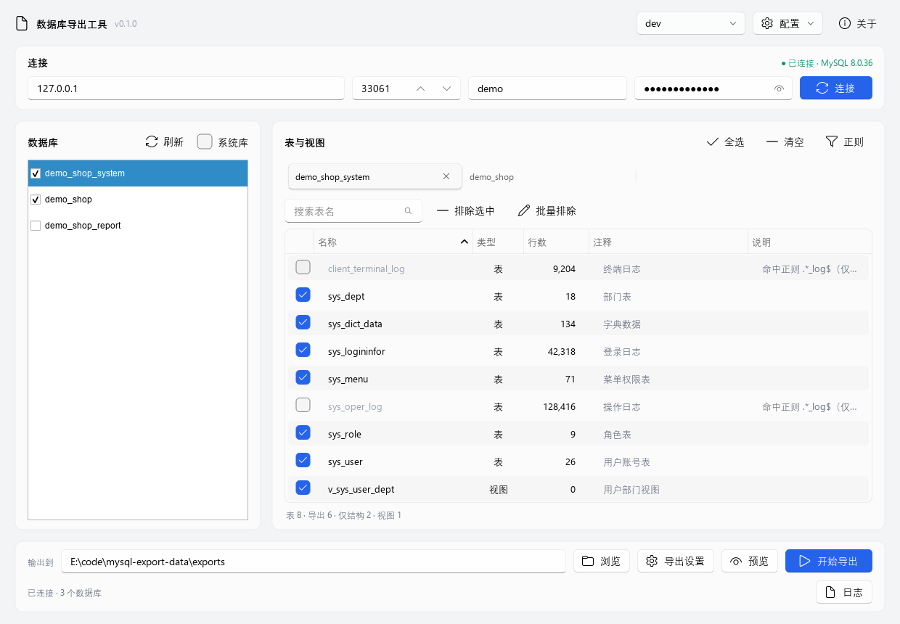
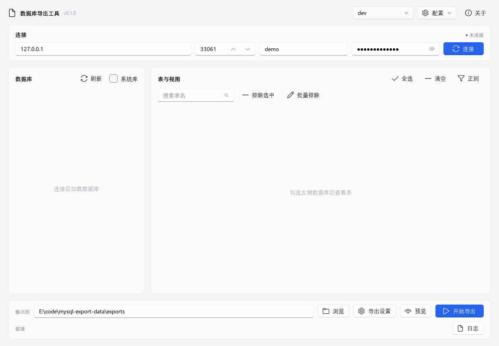

# 数据库导出工具（MysqlExportTool）

把 MySQL / MariaDB 数据库导出为可直接导入的 `.sql` 文件。连接信息、要导出的库、要排除的表都在界面里配置；**被排除的表只保留建表语句，不导出数据**。

当前版本 `v0.1.0`，交付形态为 Windows 10/11 x64 单文件 exe（`MysqlExportTool.exe`），目标机器无需安装 Python。导出的 `.sql` 在导入时需要 MySQL 客户端（`mysql` 命令）。

## 功能

- 连接任意 MySQL/MariaDB 服务器（数据库类型当前固定为 MySQL，兼容 MariaDB）；多套连接配置可新建、复制、重命名、删除、切换与保存
- 密码用 Windows DPAPI 加密后保存到 `config.json`，界面掩码显示（点密码框右侧的眼睛图标可临时查看）；日志、界面与异常信息不出现明文密码
- 点「连接」成功后，状态徽标显示服务器 MySQL 版本并自动加载数据库列表；「数据库」卡片右上角「刷新」可重新加载，「系统库」复选框控制是否显示系统数据库
- 连接成功后自动回显上次勾选的数据库与当前库；勾选任意数据库后，右侧按库分 Tab（IDEA 风格：可关闭、鼠标滚轮横向滚动、溢出时 Tab 下方显示横向滚动条；关闭 Tab 会同步取消左侧勾选；点左侧库会同步切换 Tab），切换库不用回到左侧列表；每个 Tab 的表/视图清单显示名称、类型（TABLE/VIEW）、行数、表注释与说明；行数先显 InnoDB 估算值（带 ~），随后自动后台 COUNT(*) 刷新为精确值；可点击表头按名称/类型/行数/注释/说明排序
- 快速排除表：Tab 内搜索表名 → 多选行点「排除选中」；或「批量排除」粘贴一批表名（可应用到所有已勾选库）；也可点「正则」按规则排除（可应用到所有已勾选库）。命中的表会锁定为仅结构并在说明列标注原因
- 排除表仍有建表语句（默认含 `DROP TABLE IF EXISTS`），但文件中不出现该表的任何 `INSERT`
- 每库一个 `.sql`（建表 + 数据 + 视图，视图统一在所有表之后），可直接导入
- 导出前可预览（不写文件，显示每库导出表/仅结构/视图数量与估算行数）；导出中可取消；单库/单表失败不影响其它库表，已写文件保持可导入
- 导出进度显示当前库、当前表、已导行数与耗时；完成后弹出汇总报告，可打开输出目录
- 界面导出时，输出目录同时生成 `export-<yyyyMMdd_HHmmss>.log` 日志；日志默认收起，点右下角「日志」展开
- 全程只读取源库（`SELECT` / `SHOW` / `information_schema`），不修改源库数据
- 大表流式读取（游标分批，默认每批 1000 行），内存占用不随表增大

## 界面预览

已连接并加载库表后的主界面：



未连接时显示引导空态：



## 快速开始

1. 双击 `MysqlExportTool.exe`（窗口标题：`数据库导出工具 v0.1.0`）。
2. 在「连接」卡片填主机、端口、用户名、密码，点「连接」；成功后状态徽标显示 MySQL 版本。
3. 连接成功后数据库列表自动加载；在左侧勾选要导出的库（「系统库」可切换显示系统数据库，「刷新」可重新加载）。
4. 右侧出现对应库的 Tab；在 Tab 里用搜索框找表，多选后点「排除选中」，或点「批量排除」粘贴表名：**被排除的表 = 只导建表，不导数据**。也可用「正则」按规则排除。
5. 在底部「输出到」选择输出目录（默认 exe 同目录 `exports/`）；点「导出设置」弹出 Fluent 设置窗口，可改「文件名带时间戳」「不输出 DROP」「中文转十六进制」「批量大小」。
6. 点「预览」核对导出清单（不写文件），再点「开始导出」。
7. 导出结束后在报告里查看每库文件、表数、行数与错误；可点「打开输出目录」。导出过程中可点进度条右侧「取消」。

## 配置与密码

- **配置文件位置**：优先 exe 同目录 `config.json`（便携用法）；该目录不可写时回退到 `%APPDATA%\MysqlExportTool\config.json`。实际生效路径可在顶部「配置」菜单里点「打开配置目录」查看；同一菜单还提供新建/复制/重命名/删除/保存配置。命令行 `--config` 可为 `--dry-run` 指定其它配置文件。
- **密码**：只保存 Windows DPAPI 密文（字段 `password_dpapi`），同一 Windows 用户在同一台电脑上自动解密；**换电脑或换 Windows 用户后需要重新输入密码**（程序会提示，不会崩溃）。
- **每套配置保存的内容**：连接信息、按库的排除表与正则、上次勾选的库、导出选项（时间戳/DROP/中文十六进制/批量大小）、上次输出目录。
- **配置文件损坏**：自动备份为 `config.json.bak-<时间戳>` 并重建默认配置，界面日志会给出提示。
- **默认输出目录**：exe 同目录 `exports/`；该目录不可写时使用 `%USERPROFILE%\Documents\MysqlExportTool\exports`。
- 配置采用原子写入（先写 `.tmp` 再替换），避免写到一半损坏。

## 导出内容说明

每个库生成一个 `<库名>.sql`；在「导出设置」勾选「文件名带时间戳」时为 `<库名>_<yyyyMMdd_HHmmss>.sql`。文件顺序固定：

1. 文件头注释：库名、生成工具与时间、排除表清单（`-- excluded tables (structure only): ...`）
2. `SET NAMES utf8mb4;` 与 `SET FOREIGN_KEY_CHECKS=0;`
3. 每个表：`DROP TABLE IF EXISTS`（在「导出设置」勾选「不输出 DROP」时不写）+ `CREATE TABLE` + 逐行 `INSERT`（该表若被排除则**没有 INSERT**）
4. 所有视图：`DROP VIEW IF EXISTS` + `CREATE VIEW`（统一放在全部表之后；视图被取消勾选或命中正则时不输出）
5. 文件尾：`SET FOREIGN_KEY_CHECKS=1;`

补充说明：

- 导出文件**不包含** `CREATE DATABASE` / `USE` 语句，导入前请先建好空库，并在导入命令中指定目标库。
- **中文与字符集**：中文等非 ASCII 字符默认转成 `_utf8mb4 0x...` 十六进制（表名、列名等标识符仍按原样保留），避免导入端字符集不一致导致乱码；在「导出设置」取消勾选「中文转十六进制」时写普通转义字符串（UTF-8）。
- 单表格式为逐行 `INSERT`，便于阅读与粗粒度排查；每张表末尾有 `-- table <表名> rows: N` 注释。
- 取消导出时会补齐文件尾并正常关闭文件，报告状态为「已取消」，已写内容可导入。

导入示例（先在目标 MySQL 上建好空库 `db_a`）：

```bash
# bash / Git Bash / WSL：直接重定向
mysql --default-character-set=utf8mb4 -u 用户名 -p db_a < db_a.sql
```

```powershell
# Windows PowerShell 不支持 "<" 重定向，交给 cmd 执行
cmd /c "mysql --default-character-set=utf8mb4 -u 用户名 -p db_a < db_a.sql"
```

## 命令行

以下参数同时适用于 `MysqlExportTool.exe` 与源码目录下的 `python -m app`。

> 说明：exe 以窗口程序方式打包（无控制台），不会在终端显示文字输出；`--selftest` 的结果请以 `selftest.log` 与退出码为准，需要终端输出（尤其是 `--dry-run`）时请在源码目录使用 `python -m app ...`。

```powershell
# 查看版本
python -m app --version          # 输出 MysqlExportTool v0.1.0
.\MysqlExportTool.exe --version

# 内置自检：不连数据库、不启动界面
.\MysqlExportTool.exe --selftest # 结果写入 exe 同目录 selftest.log
python -m app --selftest

# 预览导出清单（dry-run：连接数据库并分类，不写任何文件）
python -m app --dry-run --profile dev --databases db_a,db_b
python -m app --dry-run --config D:\tools\MysqlExportTool\config.json --profile dev
python -m app --dry-run --databases db_a --exclude-tables sys_oper_log --exclude-regex ".*_log$"
# exe 同样支持（无控制台输出，结果需写日志或改用源码模式查看）
.\MysqlExportTool.exe --dry-run --config D:\tools\MysqlExportTool\config.json --profile dev --databases db_a,db_b
```

- `--version`：打印版本号。
- `--selftest`：用内置内存数据跑一遍导出并校验产物（不连数据库、不启动界面），自检结果末尾为 `SELFTEST OK`；结果同时写入 exe 同目录 `selftest.log`（该目录不可写时写临时目录）。退出码 `0`=通过，`1`=失败。
- `--dry-run`：按配置连接数据库、发现库表并打印分类统计（导出表、仅结构、视图、估算行数），**不写任何文件**。库清单优先用 `--databases`，否则用上次在界面勾选的库；`--profile` 不指定时用当前激活配置；`--exclude-tables` 与 `--exclude-regex` 在界面已配置的排除规则之上追加（`--exclude-regex` 可重复）。退出码 `0`=成功，`1`=有库失败，`2`=配置不完整或未指定库。
- `--config`：仅在 `--dry-run` 时用于指定配置文件路径。
- `--outdir`：预留参数，当前版本不生效（`--dry-run` 不写文件；导出目录以界面设置为准）。

## 常见问题

- **连不上 / 超时 / 认证失败**：检查主机、端口、防火墙，以及账号是否允许从当前主机登录。错误提示会区分：`1045` 用户名或密码错误、`2003`/`2013` 无法连接主机或连接中断、`1049` 库不存在、`1044`/`1142` 权限不足（对库或表的 `SELECT` 权限）。
- **大表导出很慢**：正常现象，需要逐批读取并逐行写 `INSERT`；界面会实时显示已导行数，可随时点「取消」，已写内容保持可导入。可把「批量大小」调大减少批次数。
- **中文乱码**：保持默认的「中文转十六进制」，导入时加 `--default-character-set=utf8mb4`。若关闭该选项，导出文件是 UTF-8 文本，导入命令同样加该参数。
- **换电脑/换 Windows 用户后提示重新输入密码**：DPAPI 密文只能由同一 Windows 用户在同一台机器上解开，重新输入并保存即可。
- **导出文件已存在**：在「导出设置」未勾选「文件名带时间戳」时，导出前会弹窗确认覆盖；取消则本次不导出。
- **报告显示「部分成功」或「失败」**：单库/单表失败不影响其它内容，失败原因在报告的「错误」列和日志中；常见原因是权限不足或视图定义不可读。
- **没有可导出的表**：检查数据库是否勾选、表是否被排除；勾选库后表清单默认全部导出，取消勾选即排除。
- **行数带 ~**：表示 InnoDB 估算值，列表加载后会自动精确统计并去掉 ~；大表可能多等一会儿，切换库 Tab 会取消未完成的统计（已统计的会缓存）。
- **表清单加载慢/一直显示「加载中」**：表清单已改为先用 SHOW FULL TABLES 秒开，行数估算带 1.5 秒超时（超时显示为空/0）；界面会显示已等待秒数。若仍长时间不动，检查数据库服务器负载或元数据锁。
- **配置文件损坏**：程序自动备份为 `config.json.bak-<时间戳>` 并重建默认配置，到界面日志查看提示。
- **杀毒软件误报**：PyInstaller 单文件 exe 偶发误报，可加入信任，或按「开发」一节自行打包。
- **IDE/终端里运行报 `No module named 'PySide6'`**：说明当前 Python 解释器没装依赖。PyCharm 常见原因是运行配置指向了别的项目的解释器（`.idea` 里残留的旧 SDK）；把当前运行配置的 Python interpreter 改成项目默认（本项目 `.venv`）或 Anaconda 环境，或直接 `python -m pip install -r requirements.txt`。
- **报 `QtCore: DLL load failed` / `找不到指定的程序`**：PySide6 版本过新（如 6.12）与本机 VC 运行时不匹配；执行 `python -m pip install "PySide6==6.9.2"` 降到已验证版本即可。
- **界面控件错位/样式异常**：本界面基于 PySide6-Fluent-Widgets，请确认 `python -m pip install -r requirements.txt` 已装齐；不同 Windows 缩放比例下如有个别控件尺寸问题，反馈截图即可。
- **日志在哪里**：界面导出时输出目录生成 `export-<时间戳>.log`；`--selftest` 写入 selftest.log（普通运行时在 exe 同目录，打包脚本冒烟时为 `dist/selftest.log`）。

## 开发

环境：Windows 10/11 x64、Python 3.11+（推荐 3.13）；界面依赖 PySide6 + QFluentWidgets，打包需要 PyInstaller 6.19+，生成图标需要 Pillow。

```powershell
python -m pip install -r requirements.txt   # 运行与开发依赖
python -m pytest -q                          # 单元测试（全部使用内存方言/临时目录，不需要真实 MySQL）
python -m app                                # 源码模式启动界面（等价于无参运行）
python app/main.py                           # 也可以直接运行入口文件（已自动处理 sys.path）
python -m app --version                      # 命令行入口
powershell -ExecutionPolicy Bypass -File build/build.ps1   # 打包单文件 exe
```

打包产物：`dist/MysqlExportTool.exe`（PyInstaller onefile，无 Python 环境可运行）。构建脚本会重建 `build/_work` 与 `dist`、按需生成图标 `build/app.ico`、运行 exe 的 `--selftest` 做冒烟（结果写 `dist/selftest.log`），并打印 exe 体积与 SHA256。

代码结构：

- `app/core/`：数据模型、config/DPAPI、分类规则、SQL 写出、runner 编排（零 Qt 依赖，可单测、可复用）
- `app/dialects/`：`Dialect` 抽象 + MySQL 实现（PyMySQL）+ `MemoryDialect`（自检与单测用，不连真实库）
- `app/ui/`：PySide6 + QFluentWidgets 界面、组件与后台线程
- `app/cli.py`、`app/selftest.py`、`app/main.py`：命令行、自检与程序入口
- `tests/`：pytest 测试（GUI 测试使用 offscreen 平台，不弹窗）
- `build/`：PyInstaller 打包脚本、图标生成与版本信息

开发模式下，配置文件默认在项目根目录 `config.json`（已 gitignore）。设计文档见 [docs/superpowers/specs/2026-11-03-mysql-export-tool-design.md](docs/superpowers/specs/2026-11-03-mysql-export-tool-design.md)。

## 许可

- PySide6 / Qt 6：LGPL v3（Qt Company 版权）；本程序以动态链接方式使用，可替换 Qt 库。
- PySide6-Fluent-Widgets（QFluentWidgets）1.11.3：GPLv3 / 商业双许可；**本工具仅在公司GPLv3 使用**（未对外分发），如后续对外交付需改用商业授权或替换 UI 层。
- PyMySQL：MIT。
- Pillow：仅在构建期用于生成图标，不随 exe 分发。
- 随 exe 分发的组件（Python 运行时、PyInstaller 引导程序等）许可见 `THIRD_PARTY_LICENSES`。

完整第三方许可与归属声明见 [THIRD_PARTY_LICENSES](THIRD_PARTY_LICENSES)。


## 许可证

本项目以 **GPLv3** 发布（见 LICENSE）。界面组件库 PySide6-Fluent-Widgets 采用 GPLv3/商业双许可；
如需闭源分发，请购买其商业授权。
